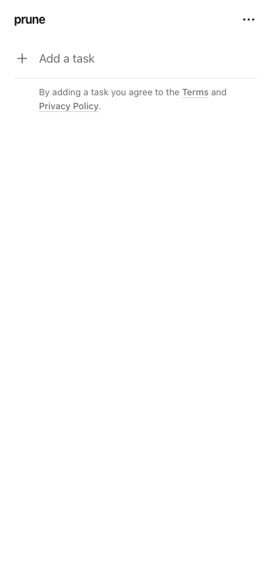
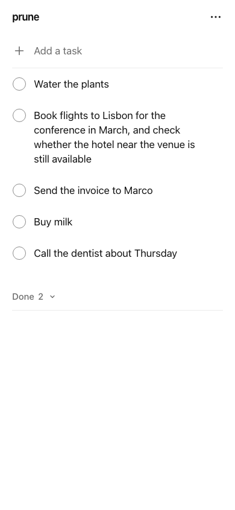
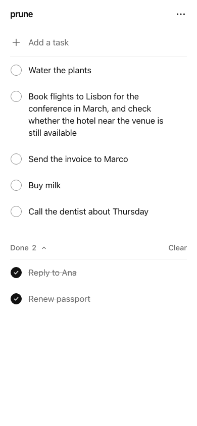

# prune

**A to-do list. Nothing else.**

prune is the easiest to-do list there is. Open it and type a task: there is nothing to sign up for. Press Enter to add it, tick it off when it's done, tap it to change it or delete it. Your list is saved as you go.

  
  
  

Try it at [prune.win](https://www.prune.win).

Setup, configuration, Google sign-in, deployment and testing are documented in [docs/development.md](docs/development.md).
