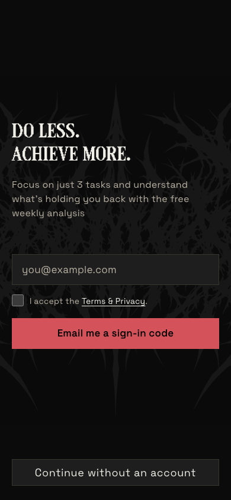
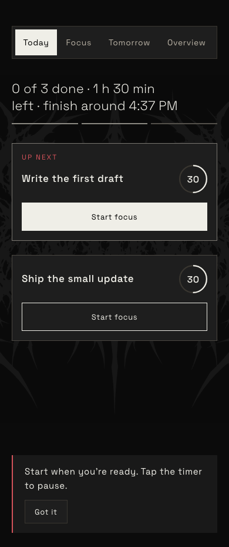
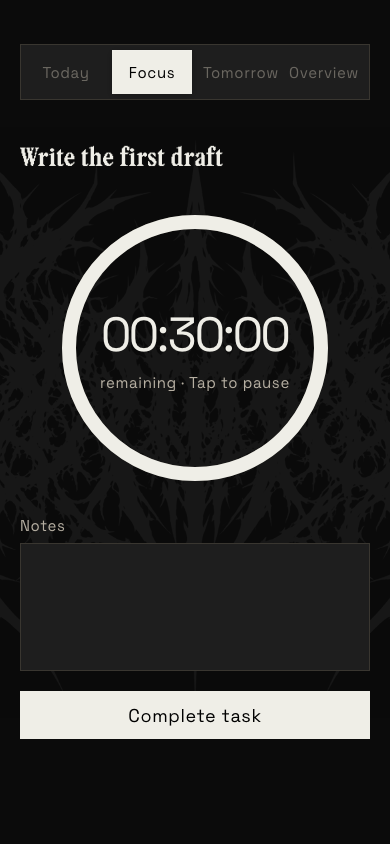

# prune

**Do less. Achieve more.**

prune is a simple daily planner. Each day you pick up to five tasks, focus on them one at a time with a timer, and get a free weekly check-in: how your estimates held up, what you really finish, and a plan for next week.

It works on your phone and in the browser.

  
  
  

Try it at [prune.win](https://www.prune.win).

Setup, configuration, Google sign-in, deployment and testing are documented in [docs/development.md](docs/development.md).
