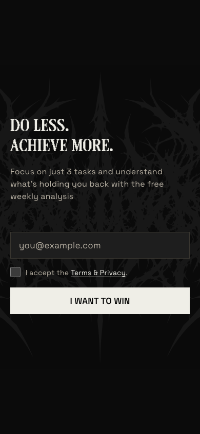
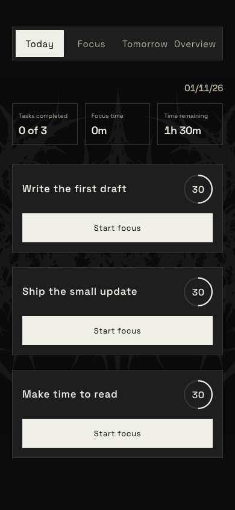
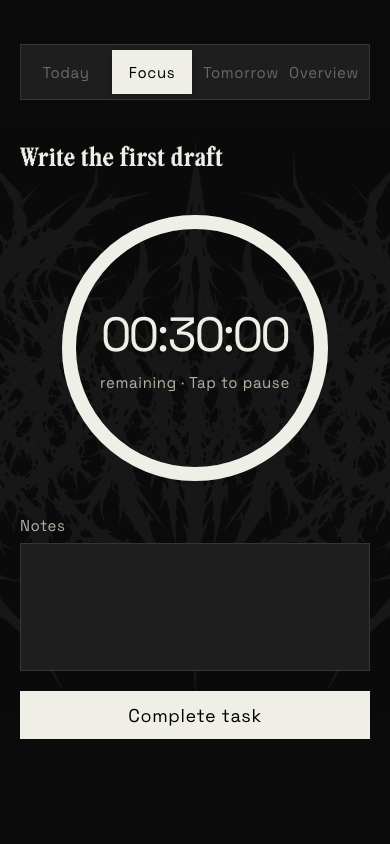

# prune

**Do less. Achieve more.**

prune is a simple daily planner. Each day you pick just three tasks, focus on them one at a time with a timer, and get a free weekly review that shows what's holding you back.

It works on your phone, in the browser, and on Mac.

  
  
  

Try it at [prune.win](https://www.prune.win).
